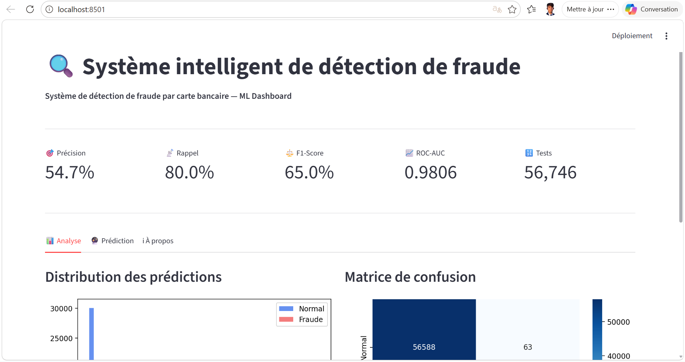

# 🛡️ Smart Fraud Detection


[Installation](#installation-sur-windows) · [Entraînement](#entraîner-et-évaluer-le-modèle) · [Démo dans VS Code](#lancer-la-démo-dans-vs-code) · [Captures](#captures-décran) · [Résultats](#résultats)

---

Projet de détection de fraude à la carte bancaire. Il compare une régression logistique, une forêt aléatoire et XGBoost, puis expose le modèle retenu via FastAPI et un tableau de bord Streamlit.

Le jeu de données d'origine contient 284 807 transactions anonymisées, dont 492 fraudes. [Credit Card Fraud Detection sur Kaggle](https://www.kaggle.com/mlg-ulb/creditcardfraud/)

## Installation sur Windows

Depuis le dossier qui contient les dépôts, cloner le projet si nécessaire, puis ouvrir PowerShell à la racine du dépôt. Utiliser Python 3.11 ou 3.12.

```powershell
git clone https://github.com/saadshr/fraud_detection.git
Set-Location fraud_detection
python -m venv .venv
.\.venv\Scripts\python.exe -m pip install -r requirements.txt
New-Item -ItemType Directory -Force data/raw
```

Télécharger et extraire `creditcard.csv` depuis Kaggle, puis placer le fichier dans `data/raw/creditcard.csv`. Git ignore les données, les modèles et les graphiques générés.

## Entraîner et évaluer le modèle

```powershell
.\.venv\Scripts\python.exe src/02_data_cleaning.py
New-Item -ItemType Directory -Force outputs
.\.venv\Scripts\python.exe src/05_train_models.py
.\.venv\Scripts\python.exe src/06_evaluate.py
```

Le script de préparation crée les fichiers d'entraînement et de test sous `data/processed/`. Il applique SMOTE au jeu d'entraînement. Le script d'entraînement affiche la précision, le rappel, le score F1 et la ROC-AUC, puis écrit dans `models/fraud_model.pkl` le modèle qui obtient le meilleur F1 sur le jeu de test. Le script d'évaluation produit `outputs/05_evaluation.png`.

Pour explorer les données, utiliser `src/01_data_exploration.py`, `src/03_eda.py` ou le [notebook d'exploration](notebooks/01_exploration.ipynb). Le script `src/04_feature_engineering.py` génère des CSV supplémentaires. L'entraînement actuel lit `X_train.csv` et `X_test.csv`.

## Lancer la démo dans VS Code

1. Dans VS Code, ouvrir le dossier `fraud_detection` via **Fichier → Ouvrir le dossier**.
2. Ouvrir **Terminal → Nouveau terminal**. Après la préparation des données et l’entraînement, lancer Streamlit depuis la racine du projet.

```powershell
.\.venv\Scripts\python.exe -m streamlit run dashboard/app.py
```

3. Garder le terminal ouvert et ouvrir [localhost:8501](http://localhost:8501) dans le navigateur. Utiliser `Ctrl+C` dans le terminal pour arrêter le serveur.

Sur une installation où les dépendances sont déjà disponibles avec `python`, la commande `python -m streamlit run dashboard/app.py` fonctionne aussi.

### Vérifier la page

1. Dans **Analyse**, vérifier que la précision, le rappel, le F1, la ROC-AUC et la matrice de confusion s’affichent.
2. Dans **Prédiction**, cliquer sur **Analyser** avec l’exemple prérempli. La page affiche la classe prédite et la probabilité de fraude. Le nombre de variables et leur ordre suivent le modèle entraîné et les colonnes du CSV de test.
3. Remplacer le contenu par `1, 2` et cliquer à nouveau sur **Analyser**. La page doit afficher un message indiquant le nombre de valeurs attendu.

### API facultative

Pour lancer FastAPI en parallèle, ouvrir un deuxième terminal.

```powershell
.\.venv\Scripts\python.exe -m uvicorn api.main:app --reload
```

Swagger est accessible sur [127.0.0.1:8000/docs](http://127.0.0.1:8000/docs). `GET /health` indique si le modèle est chargé. `GET /model/info` décrit le modèle. `POST /predict` reçoit une liste numérique `features` déjà prétraitée, dans l’ordre des colonnes de `data/processed/X_test.csv`.

## Captures d’écran

[](screenshots/dashboard.png)

[Voir la capture de l’API dans Swagger](screenshots/api.png)

## Résultats

Exécution locale du 11 novembre 2026 sur le jeu de données Kaggle. Le pipeline a comparé les trois modèles sur 56 746 transactions de test, dont 95 fraudes.

- **Forêt aléatoire** · précision 54,68 %, rappel 80,00 %, F1 0,6496 et ROC-AUC 0,9806.
- **XGBoost** · précision 37,86 %, rappel 82,11 %, F1 0,5183 et ROC-AUC 0,9715.
- **Régression logistique** · précision 5,33 %, rappel 87,37 %, F1 0,1004 et ROC-AUC 0,9619.

La forêt aléatoire a détecté 76 fraudes, en a manqué 19 et a produit 63 fausses alertes. Ces mesures décrivent cette exécution. Le pipeline utilise le même jeu de test pour sélectionner le modèle et rapporter ses scores.

Le rapport d’évaluation et le graphique de cette exécution se trouvent localement dans `outputs/evaluation-results.txt` et `outputs/05_evaluation.png`.

## Auteur

Saad Sahraoui · [GitHub](https://github.com/saadshr) · [LinkedIn](https://linkedin.com/in/saadshr)
